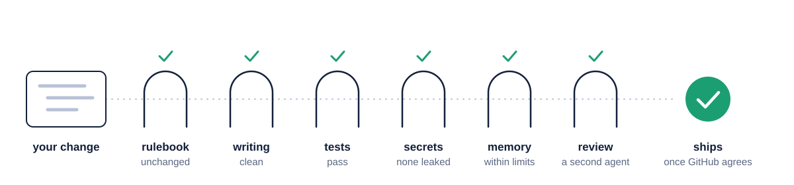
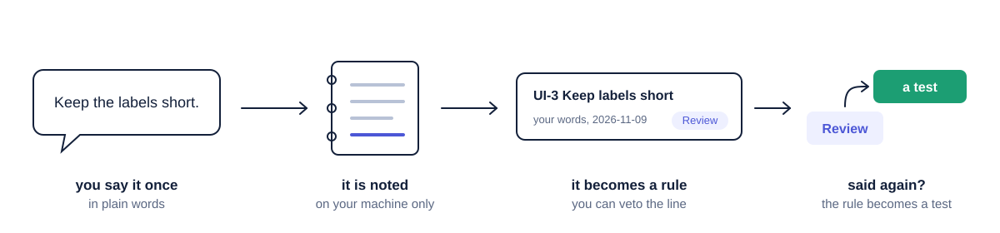

<h1 align="center"></h1>

**This is a starting point for any project you build with an AI coding agent**
(Claude Code, Codex, or any agent that reads `AGENTS.md`). It has no app code
in it. It has the habits: rules the agent follows, checks that catch its
mistakes, and a memory that gets better each time you work together.

## What it does for you

<table>
<tr>
<td width="50%" valign="top"><b>Keeps the rules fixed</b><br>The agent's rulebook is locked with a fingerprint. Only you can change it.</td>
<td width="50%" valign="top"><b>Checks every change</b><br>One script runs every check, on your machine and again on GitHub.</td>
</tr>
<tr>
<td valign="top"><b>Writes down what it learns</b><br>After each task it notes what the evidence showed. You decide which notes become lessons.</td>
<td valign="top"><b>Dreams</b><br>When the work is done it reads back what happened and proposes fixes. You pick which to keep.</td>
</tr>
<tr>
<td valign="top"><b>Learns your taste</b><br>Say a preference once and it becomes a rule. Say it twice and it becomes a test.</td>
<td valign="top"><b>Forgets on purpose</b><br>Memory has hard limits, so old notes are archived instead of piling up.</td>
</tr>
</table>

## Before you start

Run `bash scripts/doctor.sh`. It runs each tool the template uses, says which
are missing or broken, and prints the install command for your system. It
installs nothing.

## Start a project in three steps

1. Click **Use this template** on GitHub, or clone this repository into a new folder.
2. Open your coding agent in that folder.
3. Paste this prompt:

```
Follow docs/procedures/discover.md and then docs/procedures/start.md with one batched interview. Do not touch the kernel. Ask before the first push, tag or repository setting.
```

The agent looks at what your project needs, asks you one batch of questions,
sets up the checks for your language, and makes the first commit once
everything passes. `START_REPORT.md` tells you what it found, what it set up
and what is still missing.

Already have a project? See [Add it to an existing project](#add-it-to-an-existing-project).

## A day with the agent

<p align="center"></p>

- **Start a task.** `scripts/new-task.sh my-feature` makes a branch and a short
  plan in `.work/TASK.md`: the goal, how you will know it is done, and the steps.
- **While working.** `./scripts/check.sh --quick` runs the fast checks.
- **Before shipping.** `./scripts/check.sh` runs all of them. Work merges only
  after the same checks pass on GitHub.
- **After the task.** A short retro writes down what the evidence showed.

## Say it once

<p align="center"></p>

In Claude Code, each message you send is noted on your machine, with what was
happening at the time. The note is never committed. When you state a
preference, the agent adds it as a rule in `docs/preferences/` and shows you
the line, so you can say no. If you have to repeat yourself, the next dream
spots it and proposes a test, so the rule cannot be missed again. Work you
approved becomes the baseline the next version starts from, and a reviewer
checks every first draft against your rules before you see it.

## Dreaming

When a session's work is done, Claude asks whether to dream (`/dream`).

1. A script boils the session transcripts down to what matters.
2. A separate agent compares that with what the project remembers.
3. You get a numbered list of proposals and pick the numbers to keep.

A scorecard counts which kinds of proposals you accept, so each dream knows
what was useful last time. A taste pass does the same for your style in one
project: it proposes preference rules from that project's own sessions, and the
ones you approve become rows in `docs/preferences/`. Git carries them to your
other computers, and every session start loads them. Rules move to another
project only when you ask (`scripts/preferences.sh port`).

## Reference

<details>
<summary><b>What you need installed</b></summary>

`bash scripts/doctor.sh` checks all of this and prints what to install.

Required:
- git.
- bash 3.2 or newer (on Windows, Git Bash; `scripts\check.cmd` forwards to it).
- Python 3, as `python3` or `python`: validates `.claude/settings.json`, runs
  the dream and preference tools and the feedback hook. A Windows Store stub
  that does not run is skipped.
- ruff 0.16.10, `uvx` or `pipx`, template repository only: `check.sh` in
  template mode lints the template's own Python with exactly this version.
  Started projects do not need it.

Recommended:
- gh (GitHub CLI): CI watching, repo settings, branch protection. Without it
  those steps are done by hand and `scripts/ci-watch.sh` cannot run.
- gitleaks: the secret scan. Without it start logs the gap and CI is the only
  scan.
- git-cliff: CHANGELOG generation and its freshness check. Without it the
  changelog is written by hand.
- `git grep -P` (git built with PCRE): the no-dash scan. Without it the scan
  is deferred to CI.

</details>

<details>
<summary><b>What start does</b></summary>

Discover writes `docs/CAPABILITY_MAP.md`: what the agent automates, which CLI
and MCP tools exist, and which tools to build. Start asks one batched
interview, selects profiles, wires the stack into `scripts/stack-check.sh` and
`.github/workflows/ci.yml`, fills the Project decisions in AGENTS.md, writes
ARCHITECTURE and the first ADR, scaffolds tests, and rewrites this README for
your project. The first commit and the `v0.1.0` tag are made once
`./scripts/check.sh` passes for real; CI on that SHA is confirmed with
`scripts/ci-watch.sh`.

</details>

<details id="add-it-to-an-existing-project">
<summary><b>Add it to an existing project</b></summary>

1. Open an AI session in the existing repository.
2. Paste this prompt, replacing the two placeholders with this repository's
   URL and the latest `template-v` tag:

```
Adopt the project template from <TEMPLATE URL> at tag <TAG> into this repository. Read its AGENTS.md and docs/procedures/upstream.md. First list every file you would add or change and stop for my approval. Then copy the core file set without overwriting existing files, run docs/procedures/discover.md and docs/procedures/start.md in existing-project mode with one batched interview, wire scripts/stack-check.sh to this project's existing commands, quarantine any test that already fails with an owner task, and record the adoption as an ADR with the template tag. Do not touch CI, branch protection or tags without asking.
```

3. An existing AGENTS.md or CLAUDE.md is merged by hand, never replaced; its
   project content moves under Project decisions. Failures that already exist
   go to BACKLOG.md; tests that already fail go to `tests/quarantine.list`
   with an owner and date. Neither is fixed during adoption.

</details>

<details>
<summary><b>Day-to-day commands</b></summary>

- Begin a task: `scripts/new-task.sh <slug> [standard|quick|autopilot]`
  creates the branch and `.work/TASK.md`, and lists the preference areas and
  baselines that match the task name.
- While working: `./scripts/check.sh --quick` (or `scripts/quickgate.sh`, the
  same lane). Before shipping: `./scripts/check.sh`. Shipping is a gated
  merge: the work goes through a branch and merges only after the gauntlet is
  green on CI.
- At milestones run `docs/procedures/bughunt.md`; at the end of every task
  run `docs/procedures/retro.md`; run `docs/procedures/maintain.md` monthly.
- Dreaming: `docs/procedures/dream.md`. `scripts/dream.sh scorecard` prints
  the scorecard on its own.
- Preferences: `docs/procedures/preferences.md`. `scripts/preferences.sh
  check` validates the registers.
- Tags: the template is tagged `template-vX.Y.Z` by
  `scripts/template-release.sh`; a project built from it is tagged `vX.Y.Z`.

</details>

<details>
<summary><b>How preferences are stored</b></summary>

- **Capture.** A UserPromptSubmit hook logs each message with its situation
  (task, branch, files being worked on, what the agent just said) to
  `.work/feedback/log.jsonl`. The log stays on your machine. A script guesses
  the kind: correction, preference, approval, deferral or plain message.
- **Registers.** Lasting preferences live in `docs/preferences/<area>.md`.
  Each rule carries its source (the date and your words) and either a named
  check that fails when the rule is broken, or `Review`.
  `scripts/preferences.sh check` runs inside `./scripts/check.sh`.
- **Repeats.** The dream flags feedback that repeats an existing rule and
  proposes moving that rule from `Review` to a named check.
- **Baselines.** An approved deliverable is recorded as the baseline for its
  kind, and a new variant starts from it.
- **Draft review.** Before you see a first draft, a reviewer checks it against
  the registers that apply and reports with evidence.

The template ships the format, the tools and the procedure; each project owns
its rows.

</details>

<details>
<summary><b>Keep a project in sync with the template</b></summary>

A project's session start says `Template update available` when a newer
`template-v` tag exists than its last sync; the `template-update` skill takes
it from there: a branch, a dry run, `scripts/template-sync.sh --latest`,
conflicts merged by hand, kernel changes stopped for the owner,
`./scripts/check.sh`, and a PR. The core file set is listed in
`docs/procedures/upstream.md`. Adopted profiles, the AGENTS.md kernel block
and the rules index are shown as diffs and never applied; the rest of the
core set applies only when the project's copy is untouched since the last
sync, and `docs/library/` and `docs/roster/` sync only where the project
carries them. The Project decisions section and the project's own stack
steps in `scripts/stack-check.sh` are never touched. A project with no
usable sync record gets candidates from `--suggest-baseline`. In the
template, `scripts/fleet.sh` lists every local project's version and status
from a gitignored `fleet.local.list`.

</details>

<details>
<summary><b>Send lessons back to the template</b></summary>

A retro lesson about how work is run (not about the product) goes to
`docs/lessons/UPSTREAM.md` in the project, tagged `core` or a profile name.
At maintenance the owner opens an issue or PR on the template with those
entries. The human approval gate decides; nothing lands unreviewed. Full
contract: `docs/procedures/upstream.md`.

</details>

<details>
<summary><b>Everything the checks enforce</b></summary>

`./scripts/check.sh` is the only gauntlet; CI runs the same script.

- Always: kernel hash verify (`.kernel.hash`); AGENTS.md at most 180 lines;
  untracked-files report; the dash and character scan (no em or en dashes,
  curly quotes, ellipsis character, non-breaking space or mojibake); the caps
  below; mirror parity (`.claude/skills` and `.agents/skills` identical, every
  `.claude/agents` file with a `.codex` counterpart or a recorded reason); the
  task graph; the task lint (`scripts/tasklint.sh check`: ticked criteria
  name evidence, assumptions carry a status); ADR numbering and format
  (`scripts/adr.sh check`); the documentation question table
  (`scripts/doc-eval.sh check`); the preference registers
  (`scripts/preferences.sh check`); `scripts/selftest.sh` whenever
  `tests/template/` exists. The full gate (not `--quick`) also runs
  `scripts/tasklint.sh ship`: no open assumption, and an autopilot task has a
  PASS plan verdict.
- Claude Code hooks: `scripts/destructive-guard.sh` refuses destructive rm and
  git forms before they run, in every session and subagent;
  `scripts/stop-gate.sh` blocks a turn end on broken task state and runs the
  quick gate once every criterion is ticked; `scripts/session-context.sh`
  loads the mode, the branch, status, recent commits, the live task and the
  preference registers; `scripts/feedback-log.sh` notes each message you send.
- Template mode (before start): template integrity, including required files,
  placeholders, skill frontmatter, settings validity, executable bits, ADR
  references and BLUEPRINT tree parity.
- Project mode (after start writes `.start-done`): the stack gauntlet wired by
  start: format, typecheck, lint with boundary rules, tests, secret scan,
  build, mutation on changed files, CHANGELOG freshness, plus each selected
  profile's gates.
- Caps: 20 approved lessons, 180 lines in AGENTS.md, the template's core
  skills (at most 8) plus 2 project skills plus the skills the adopted
  profiles declare, 40 lines per rules file. Forgetting is
  archived on evidence, never deleted.
- Self-tests: `scripts/selftest.sh` runs every fixture in `tests/template/`,
  one test file per script. `scripts/quickgate.sh` (it runs
  `./scripts/check.sh --quick`) is the fast in-work subset of the gauntlet.

</details>

<details>
<summary><b>Profiles</b></summary>

Selected at start; `software` is always on. Index: `docs/profiles/README.md`.

- software (`docs/profiles/software/`): the baseline every project gets.
- scientific (`docs/profiles/scientific/`): fixtures, golden masters, seeds, tolerances, validation status.
- embedded-firmware (`docs/profiles/embedded-firmware/`): code that drives physical outputs; safety states, host simulation.
- hardware-pcb (`docs/profiles/hardware-pcb/`): board design with decision log, requirements, issue ledger and release gate.
- data-analysis (`docs/profiles/data-analysis/`): raw instrument files and logs, import, provenance, analysis.

Each profile ships its agents (with Codex twins), skills and tested tools in
its own `agents/`, `skills/` and `tools/` folders, and start copies them in
when the profile is adopted. Optional items proven in only one project live in
`docs/library/` (agents, skills, procedures, tools, a shell hook) and are
adopted by choice (ADR 0004). `docs/roster/` holds opt-in department agents
(R&D leadership, programme, mechanical and product, electronics and firmware,
quality and safety, production, documentation, video, CG render): read-only
leads that review and decide, and specialists that each write one folder
(ADR 0005). Photoreal product stills, animation and product films use the
render roles with the library `product-render` procedure, skill and tools
(ADR 0007).

</details>

<details>
<summary><b>Procedures</b></summary>

All in `docs/procedures/`, portable to any agent.

- discover: capability discovery before start; tool inventory and build list.
- start: one-shot interview and project adaptation.
- tests: test harness and layers wired from day one.
- bughunt: proactive defect hunting from profile checklists and defect memory.
- bugfix: reproduce, root cause, failing test, smallest fix.
- audit: full-repo review with P0-P3 priorities.
- ship: done-gate, version, push, monitor CI to terminal state.
- retro: end-of-task learning capture.
- dream: memory consolidation against session transcripts, with a scorecard and a taste pass.
- preferences: capture owner feedback, registers, baselines, draft review.
- maintain: pruning, caps, freshness.
- doc-eval: a fresh agent answers a question set by navigation; traps must be declined.
- longjob: checkpointed background work.
- upstream: lessons up, template sync down, adoption.

</details>

<details>
<summary><b>Which agents it works with</b></summary>

- Claude Code: `CLAUDE.md` imports AGENTS.md; `.claude/` holds agents, skills
  and the SessionStart, UserPromptSubmit, PreToolUse and Stop hooks.
- Codex: reads AGENTS.md; `.codex/agents/`, `.agents/skills/` and
  `.codex/hooks.json` carry the same accelerators and hooks. Trust the
  project and its hooks once in Codex; the dream reads Codex sessions too.
- Any other agent: AGENTS.md and `docs/procedures/` are sufficient;
  accelerators are optional.
- Model choice: `docs/rules/models.md` defines tiers (cheap, standard, strong,
  inherit), never model names, with adapters per harness. Task decomposition
  and worker rules: `docs/rules/orchestration.md`.

</details>

<details>
<summary><b>Windows</b></summary>

On native Windows run `scripts\check.cmd`; it bypasses the execution policy
for that call and forwards through `scripts/check.ps1` to the same check.sh
via Git Bash. Git Bash is required.

</details>

## License

MIT, see LICENSE. A project built from this template may relicense itself.

## Credits

- The [AGENTS.md](https://agents.md) format carries the rules for every agent (ADR 0001).
- Dreaming follows Anthropic's agent-memory research, [The components of agent memory](https://www.anthropic.com/engineering/components-of-agent-memory) (ADR 0009).
- Declared budgets come from Karpathy's [autoresearch](https://github.com/karpathy/autoresearch) and from Claude Code's [dynamic workflows](https://code.claude.com/docs/en/workflows) (ADR 0002).
- Built for [Claude Code](https://code.claude.com/docs/en/overview) and [Codex](https://github.com/openai/codex).
- The checks and helper scripts use [git-cliff](https://git-cliff.org), [gitleaks](https://github.com/gitleaks/gitleaks), [ruff](https://docs.astral.sh/ruff/), [uv](https://docs.astral.sh/uv/) and the [GitHub CLI](https://cli.github.com).
